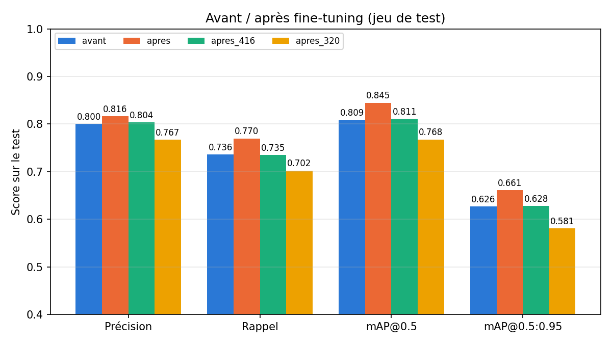
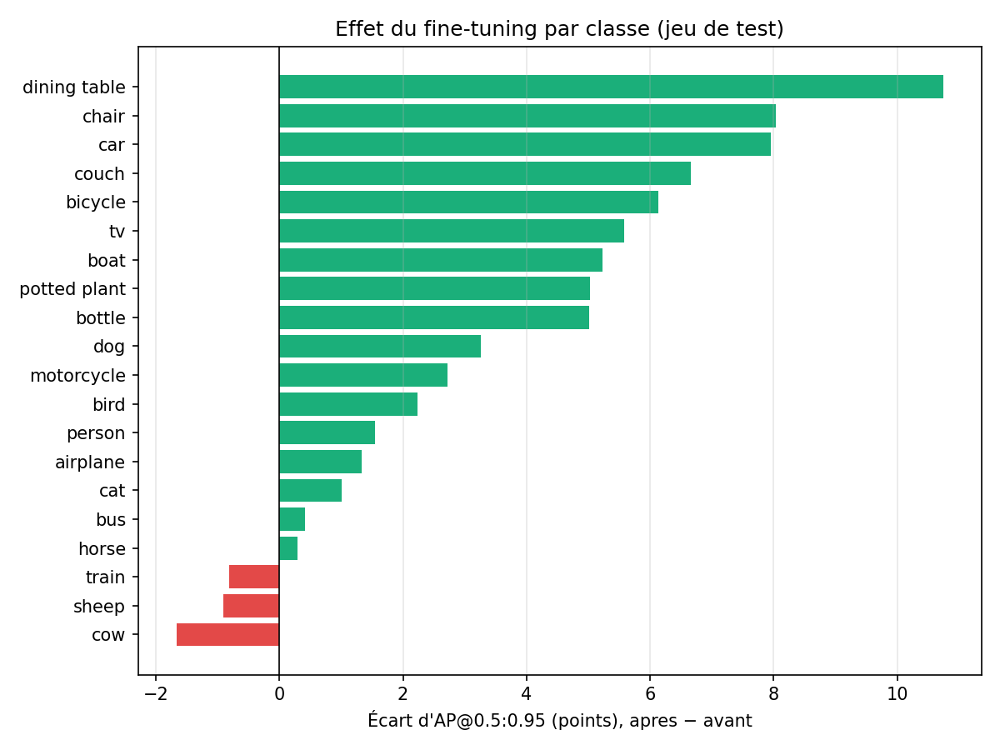
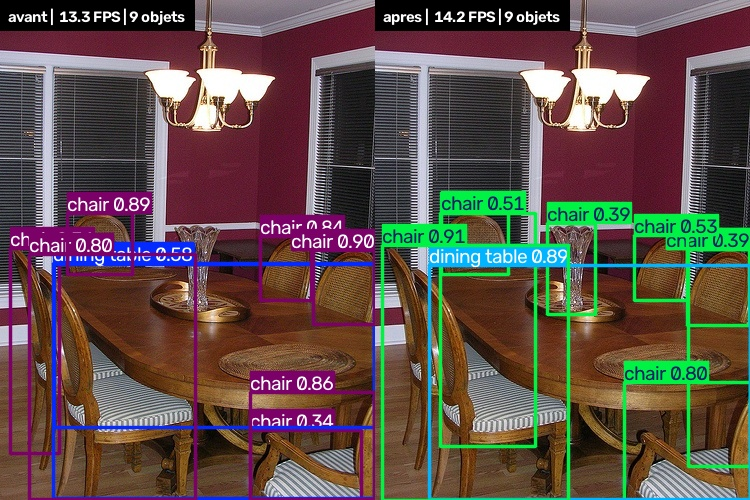
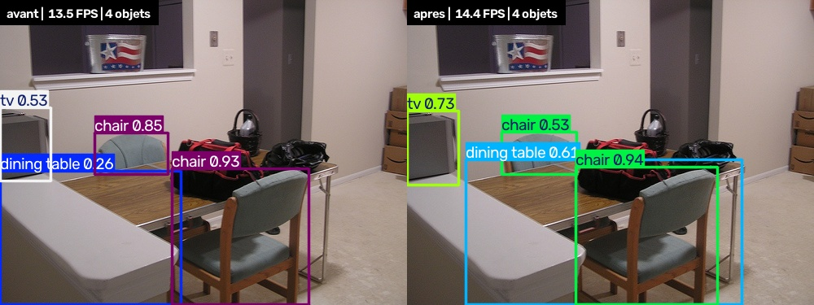
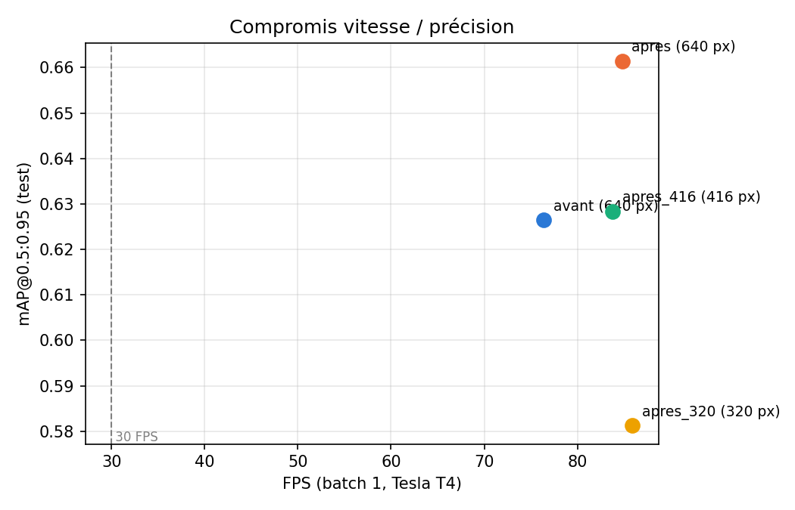

# Évaluation et comparaison avant / après fine-tuning

## Objectif

Mesurer sur le **jeu de test** (4 300 images, jamais utilisé pour l'entraînement ni pour le
choix des hyperparamètres) la précision et la vitesse du modèle d'origine (YOLO11n COCO) et
du modèle fine-tuné (`train/weights/best.pt`), dans les mêmes conditions, puis les comparer.

## Fichiers

| Fichier | Rôle |
|---|---|
| `evaluate.py` | Évalue chaque modèle sur le test (précision + vitesse), écrit les tableaux et les figures |
| `results/metrics_test.csv` | Une ligne par modèle : P, R, mAP@0.5, mAP@0.5:0.95, temps par image, FPS (GPU Tesla T4) |
| `results/ap_par_classe_test.csv` | AP@0.5 et AP@0.5:0.95 par classe et par modèle |
| `results/metrics_test.json` | Tout, plus les conditions de mesure (GPU T4, versions, réglages) |
| `results/figures/` | `comparaison_globale.png`, `ap_par_classe_<ref>_vs_<modèle>.png`, `vitesse_precision.png` |
| `results/figures/exemples/` | Images du test, modèle d'origine à gauche et fine-tuné à droite (`demo/demo.py --compare`) |
| `evaluation_colab.ipynb` | Notebook Colab : données, évaluation, démo |
| `results/val/<modèle>/` | Sorties d'Ultralytics : courbes PR, matrice de confusion |
| `baseline_colab.ipynb` | Notebook Colab de Matteo : évaluation du modèle préentraîné (sans fine-tuning) sur la validation et le test |
| `resultats/val/` et `resultats/test/` | `baseline_metrics.json` produit par ce notebook (validation : mAP@0.5 = 0,807, mAP@0.5:0.95 = 0,634 ; test : 0,809 et 0,626, identiques à la baseline de `results/`) |

## Lancement (Google Colab, GPU T4)

Le notebook `evaluation_colab.ipynb` enchaîne toutes les étapes (dépôt, données, évaluation,
démo). En ligne de commande :

```bash
pip install ultralytics
# données prêtes dans /content/datasets/VOC (voir data/README.md)
# évaluation finale : avant, après, et après à deux tailles d'image plus petites
python eval/evaluate.py --device 0 --models avant=yolo11n.pt apres=train/weights/best.pt \
    apres_416=train/weights/best.pt@416 apres_320=train/weights/best.pt@320
# refaire seulement les figures à partir de results/metrics_test.json
python eval/evaluate.py --replot
```

Le premier modèle de la liste sert de référence pour les écarts par classe. La syntaxe
`poids@taille` évalue le même modèle avec des images plus petites à l'inférence.

## Méthode

**Mêmes conditions pour tous les modèles.** Même jeu de test, même taille d'image (640 px
sauf `--imgsz-auto`), mêmes seuils (`conf=0.001`, `iou=0.7`, les valeurs d'Ultralytics pour
le calcul de la mAP), même GPU, mêmes images pour la vitesse.

**Modèle d'origine (80 classes COCO).** Ses numéros de classes ne correspondent pas à ceux
de `data.yaml`. On réutilise la fonction de la Personne 1 (`data/baseline_zeroshot.py`) : les labels du
test sont renumérotés avec les numéros COCO, et les prédictions des 60 classes COCO absentes
de VOC sont ignorées. On doit retrouver la baseline de `data/stats/baseline_zeroshot.json`
(mAP@0.5:0.95 = 0,626), ce qui sert de contrôle.

**Modèle fine-tuné (20 classes).** Il est évalué directement avec `data.yaml`.

**Vitesse.** Le `val()` d'Ultralytics mesure le temps en batch 32 : ce n'est pas la situation
du temps réel, où les images arrivent une par une. On mesure donc séparément, en **batch 1**,
sur 300 images du test préchargées en mémoire (le disque n'est pas compté), après 20
inférences de warmup (les premières sont plus lentes : allocation mémoire et initialisation
du GPU). On relève :
- `inference_ms` : réseau seul ;
- `total_ms` : prétraitement + réseau + NMS, mesuré à l'horloge ;
- `FPS = 1000 / total_ms` : images par seconde réellement traitables ;
- `total_ms_p95` : 95 % des images sont traitées en moins de ce temps (stabilité).

On considère généralement qu'un système est « temps réel » au-delà de 25 à 30 FPS.

## Résultats

Modèles comparés : `avant` = YOLO11n préentraîné sur COCO, sans adaptation ; `apres` =
`train/weights/best.pt`, le meilleur modèle de la Personne 3 (`epochs_20_complets`,
lr0 = 0,001, 20 epochs). Toutes les valeurs sont mesurées sur le **jeu de test**
(4 300 images, 10 413 objets).

Conditions : GPU Tesla T4 (Google Colab), Ultralytics 8.4.216, PyTorch 2.14.

### Contrôle

Le modèle d'origine obtient exactement la baseline de la Personne 1
(`data/stats/baseline_zeroshot.json`) : mAP@0.5 = 0,809 et mAP@0.5:0.95 = 0,626. Le script
d'évaluation est donc cohérent avec celui de la baseline.

### Avant / après fine-tuning

| Modèle | Précision | Rappel | mAP@0.5 | mAP@0.5:0.95 |
|---|---|---|---|---|
| Avant (YOLO11n COCO) | 0,800 | 0,736 | 0,809 | 0,626 |
| **Après (fine-tuné)** | **0,816** | **0,770** | **0,845** | **0,661** |
| Écart | +1,6 | +3,4 | +3,6 | +3,5 |



**Le fine-tuning améliore le modèle sur des images qu'il n'a jamais vues** : +3,6 points de
mAP@0.5 et +3,5 points de mAP@0.5:0.95. Le gain vient surtout du **rappel** (+3,4 points) :
le modèle adapté manque moins d'objets, tout en se trompant un peu moins (+1,6 point de
précision).

Le gain sur le test (+3,5 points de mAP@0.5:0.95) est du même ordre que celui mesuré sur la
validation par la Personne 3 (+3,2 points). Le risque signalé dans `train/README.md` (meilleur
epoch choisi sur la validation, donc gain peut-être optimiste) ne se confirme pas : le gain
se généralise.

### Par classe



17 classes sur 20 progressent (AP@0.5:0.95 sur le test, `results/ap_par_classe_test.csv`) :

| Classe | Avant | Après | Écart (points) |
|---|---|---|---|
| dining table | 0,494 | 0,602 | +10,7 |
| chair | 0,393 | 0,473 | +8,0 |
| car | 0,641 | 0,721 | +8,0 |
| couch | 0,565 | 0,631 | +6,7 |
| bicycle | 0,614 | 0,675 | +6,1 |
| tv | 0,626 | 0,682 | +5,6 |
| boat | 0,454 | 0,506 | +5,2 |
| potted plant | 0,319 | 0,369 | +5,0 |
| bottle | 0,503 | 0,553 | +5,0 |
| … | | | |
| train | 0,749 | 0,741 | −0,8 |
| sheep | 0,681 | 0,672 | −0,9 |
| cow | 0,720 | 0,703 | −1,7 |

Les plus forts gains concernent les classes les plus faibles au départ : objets d'intérieur
(dining table, chair, couch, tv, potted plant, bottle), souvent partiellement cachés ou
groupés, et petits objets (bottle, potted plant, d'après l'analyse de la Personne 1). Les
classes déjà très bien détectées (bus, horse, cat, airplane) bougent peu. Les trois reculs
sont faibles (moins de 2 points) et peuvent venir en partie du hasard de l'entraînement.

Comme ces 20 classes existent déjà dans COCO, le modèle n'apprend pas de nouveaux objets :
il s'adapte aux **conventions d'annotation de Pascal VOC**. Les exemples ci-dessous (images
du test, modèle d'origine à gauche, fine-tuné à droite) le montrent sur les tables : la
confiance passe de 0,58 à 0,89 sur la première image et de 0,26 à 0,61 sur la seconde, où la
télévision passe aussi de 0,53 à 0,73.




Les couleurs des boîtes diffèrent entre les deux images parce que les numéros de classes ne
sont pas les mêmes dans les deux modèles (80 classes COCO à gauche, 20 classes VOC à droite).

### Vitesse et compromis vitesse / précision

Vitesse mesurée sur le GPU Tesla T4 de Colab, en batch 1, sur 300 images du test.
« ms / image » est le temps complet d'une image (prétraitement + réseau + NMS) ;
FPS = 1000 / ce temps.

| Modèle | Taille d'image | mAP@0.5:0.95 | Réseau (ms) | ms / image | 95 % des images en moins de (ms) | **FPS** |
|---|---|---|---|---|---|---|
| Avant | 640 | 0,626 | 9,9 | 13,1 | 20,5 | **76** |
| Après | 640 | **0,661** | 8,9 | 11,8 | 13,7 | **85** |
| Après | 416 | 0,628 | 9,4 | 11,9 | 16,8 | 84 |
| Après | 320 | 0,581 | 9,3 | 11,6 | 14,1 | 86 |



**Le temps réel est largement atteint.** Le modèle fine-tuné traite une image en 11,8 ms,
soit **85 FPS**, près de trois fois le seuil habituel de 25 à 30 FPS. La démo vidéo le
confirme (entre 70 et 90 FPS affichés).

**Le fine-tuning ne coûte rien en vitesse.** L'architecture est la même ; seule la dernière
couche passe de 80 à 20 classes. Le modèle fine-tuné est même un peu plus rapide (11,8 ms
contre 13,1 ms), probablement parce que sa sortie plus petite allège le post-traitement ;
l'écart reste faible et on ne le présente pas comme un gain du fine-tuning. Le gain de
précision est donc gratuit.

**Sur GPU, réduire la taille d'image ne fait pas gagner de vitesse.** Les trois tailles
tournent à la même vitesse (de 84 à 86 FPS). Avec une seule image à la fois, un modèle aussi
petit que YOLO11n n'occupe qu'une petite partie du GPU : le temps est dominé par les coûts
fixes (lancement des calculs sur le GPU, transferts mémoire, prétraitement) plutôt que par
le nombre de pixels. En revanche, la précision baisse : à 416 px, le modèle fine-tuné revient
au niveau du modèle d'origine à 640 px (0,628 contre 0,626) ; à 320 px, il perd 8 points.
Les petits objets, qui ne font plus que quelques pixels dans les feature maps, sont les
premiers touchés (Cours 3 p.48-49).

**Conclusion pratique** : on garde le modèle fine-tuné à **640 px**, qui a la meilleure
précision et tourne à 85 FPS. Réduire la taille d'image ne se justifierait que sur un
matériel beaucoup moins puissant, sans GPU.

### Démo

`demo/demo.py` applique les modèles sur une vidéo ou la webcam et affiche les FPS en direct
(voir `demo/README.md`) ; avec `--compare`, les deux modèles sont côte à côte, comme dans les
exemples ci-dessus.

## Limites

- Un seul run par configuration : un écart de 1 à 2 points peut venir en partie du hasard.
- Les FPS dépendent du matériel : ils se comparent entre eux (même machine), pas à d'autres
  ordinateurs ou GPU.
- La réduction de taille d'image n'est testée qu'à l'inférence ; un modèle entraîné
  directement à 320 px pourrait faire un peu mieux à cette taille.
- Notre découpage 70/10/20 n'est pas le découpage officiel de VOC : les scores ne se
  comparent pas directement à ceux des articles.
