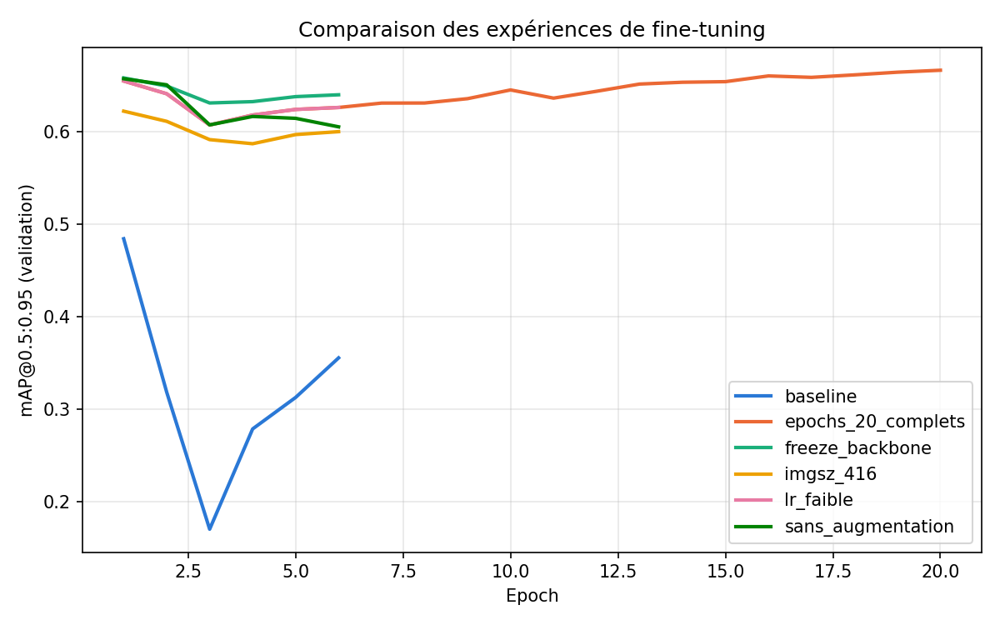
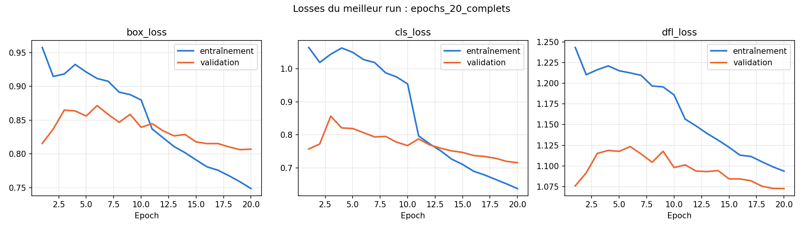

# Entraînement et fine-tuning (CRETEL Théo)

## Objectif

Adapter YOLO11n, préentraîné sur COCO, au jeu de données du projet par transfer learning,
puis étudier l'effet des principaux hyperparamètres et conserver les meilleurs poids.

## Fichiers

| Fichier | Rôle |
|---|---|
| `train.py` | Lance les expériences de fine-tuning (une configuration de référence + une variante par hyperparamètre) |
| `compare_runs.py` | Compare les runs : tableau récapitulatif, courbes, copie des meilleurs poids |
| `runs/<expérience>/` | Créé par Ultralytics : `results.csv`, `results.png`, `args.yaml`, `weights/best.pt`, `weights/last.pt` |
| `results_finetuning.csv` | Une ligne par expérience (meilleur epoch sur la validation), transmis à la Personne 4 |
| `figures/` | `comparaison_map.png` et `losses_<meilleur run>.png` |
| `weights/best.pt` | Poids du meilleur run, utilisés pour l'évaluation et la démo |

## Installation et lancement (Google Colab, GPU)

```bash
pip install ultralytics
# test rapide de la chaîne complète (8 images, quelques secondes)
python train/train.py --data coco8.yaml --epochs 3
# toutes les expériences sur le jeu de données du projet
python train/train.py --data data/data.yaml
# ou seulement certaines
python train/train.py --data data/data.yaml --exp freeze_backbone imgsz_416
# comparaison des runs
python train/compare_runs.py
```

Si la mémoire GPU est insuffisante : `--batch 8`.

## Méthode

On part des poids `yolo11n.pt` préentraînés sur COCO. Les 20 classes VOC portent leur nom
COCO : Ultralytics adapte la tête de détection à 20 classes en reprenant les poids COCO de
ces classes (« Remapped 20/20 cls head rows by class name ») ; le modèle de départ vaut donc
la baseline de la Personne 2 (mAP50-95 = 0,634 sur la validation). C'est du transfer
learning (Cours 3 p.90-100). Chaque expérience ne change **qu'un seul** hyperparamètre, en
deux étapes :

**Étape 1 : learning rate**, par rapport à la configuration de référence.

| Expérience | Changement | Justification |
|---|---|---|
| `baseline` | SGD, lr0 = 0.01, 20 epochs, imgsz 640, batch 16, aucune couche gelée, patience 5, seed 0 | Fine-tuning complet (stratégie 2, Cours 3 p.96) |
| `lr_faible` | `lr0=0.001` | Learning rate faible lors du fine-tuning (Cours 3 p.97 ; Cours 2 p.94) |

`lr0=0.01` dégrade fortement le modèle préentraîné, `lr0=0.001` l'améliore : l'étape 2 part
donc de `lr_faible`.

**Étape 2 : autres hyperparamètres**, par rapport à `lr_faible`.

| Expérience | Changement | Justification |
|---|---|---|
| `freeze_backbone` | `freeze=10` | Backbone gelé, seuls neck et tête entraînés (stratégie 1, Cours 3 p.95 et p.98 ; Fiche 09) |
| `imgsz_416` | `imgsz=416` | Compromis précision / vitesse (taille des feature maps, Cours 3 p.48-49) |
| `epochs_20_complets` | `patience=0` (les 20 epochs sans early stopping) | Effet de la durée d'entraînement (Cours 3 p.105-107) |
| `sans_augmentation` | mosaic, flip, translation, échelle et couleurs désactivés | Apport des augmentations (Fiche 04 ; invariance, Cours 3 p.12-13) |

Choix techniques :
- l'optimiseur est fixé à SGD : avec `optimizer="auto"`, Ultralytics choisit lui-même le
  learning rate et ignore `lr0`, ce qui empêcherait de le comparer ;
- les runs sont comparés sur le **jeu de validation** ; le jeu de test reste réservé à
  l'évaluation finale (Cours 3 p.104) ;
- le meilleur epoch de chaque run est celui qu'Ultralytics retient pour `best.pt`
  (critère 0.1 × mAP@0.5 + 0.9 × mAP@0.5:0.95) ;
- 20 epochs suffisent car les poids COCO connaissent déjà les 20 classes VOC ; `patience=5` arrête l'entraînement si la validation ne s'améliore plus (early stopping,
  Fiche 07) ;
- la courbe des losses entraînement / validation du meilleur run permet de détecter un
  éventuel surapprentissage (Cours 3 p.107).

## Résultats

Conditions : Google Colab, GPU Tesla T4, Ultralytics 8.4.216, PyTorch 2.14.1. Une epoch
(15 052 images à 640 px, batch 16) dure environ 4 min, validation comprise. Toutes les
valeurs ci-dessous sont mesurées sur le **jeu de validation** (2 151 images, 5 132 objets) ;
l'évaluation finale sur le test est faite par la Personne 4.

Référence : YOLO11n préentraîné sur COCO, sans fine-tuning (Personne 2), obtient sur la
validation **mAP@0.5 = 0,807 et mAP@0.5:0.95 = 0,634**.

### Étape 1 : effet du learning rate

mAP@0.5:0.95 de validation à chaque epoch :

| Epoch | `baseline` (lr0 = 0,01) | `lr_faible` (lr0 = 0,001) |
|---|---|---|
| départ (sans fine-tuning) | 0,634 | 0,634 |
| 1 | 0,484 | **0,655** |
| 2 | 0,319 | 0,641 |
| 3 | 0,170 | 0,607 |
| 4 | 0,279 | 0,618 |
| 5 | 0,313 | 0,624 |
| 6 | 0,356 | 0,626 |

Les deux runs sont arrêtés par l'early stopping à l'epoch 6 : leur meilleur score est celui
de l'epoch 1 et il n'a pas été dépassé pendant 5 epochs.

Meilleur epoch de chaque run :

| Modèle | Précision | Rappel | mAP@0.5 | mAP@0.5:0.95 |
|---|---|---|---|---|
| Sans fine-tuning (Personne 2) | 0,785 | 0,756 | 0,807 | 0,634 |
| `baseline` (lr0 = 0,01) | 0,716 | 0,613 | 0,677 | 0,484 |
| `lr_faible` (lr0 = 0,001) | **0,815** | 0,754 | **0,829** | **0,655** |

**Avec lr0 = 0,01, le fine-tuning détruit ce que le modèle avait appris.** La mAP@0.5:0.95
chute de 0,634 à 0,170 en trois epochs, puis remonte lentement. Les losses d'entraînement
augmentent en même temps (`cls_loss` passe de 1,12 à l'epoch 1 à 1,92 à l'epoch 4), signe
que les pas de gradient sont trop grands (Cours 2 p.94). Les poids préentraînés sont déjà
proches d'un bon minimum : un learning rate élevé les en éloigne. C'est exactement la mise
en garde du cours sur le fine-tuning (Cours 3 p.97 : learning rate très faible lors du
dégel, sinon on détruit les poids appris).

**Avec lr0 = 0,001, le fine-tuning améliore le modèle** : +2,1 points de mAP@0.5:0.95 et
+2,2 points de mAP@0.5 par rapport au modèle de départ, avec une précision plus élevée et un
rappel quasi identique. Les losses d'entraînement baissent légèrement.

Dans les deux runs, la mAP baisse pendant les epochs 2 et 3 puis remonte. Ces trois epochs
correspondent au warmup d'Ultralytics (`warmup_epochs=3`), pendant lequel le learning rate
monte progressivement jusqu'à `lr0` : le meilleur score est donc obtenu au début, quand le
learning rate est encore faible.

**Par classe** (AP@0.5:0.95 en validation, avant → après fine-tuning avec `lr_faible`),
16 classes sur 20 progressent. Les gains les plus nets :

| Classe | Avant | Après | Écart |
|---|---|---|---|
| car | 0,646 | 0,730 | +8,4 |
| dining table | 0,507 | 0,576 | +6,9 |
| tv | 0,601 | 0,652 | +5,1 |
| cow | 0,656 | 0,701 | +4,5 |
| boat | 0,436 | 0,479 | +4,3 |
| chair | 0,492 | 0,532 | +4,0 |

Quatre classes reculent légèrement : bus (−3,6), cat (−1,3), airplane (−0,7) et motorcycle
(−0,1). Les classes qui progressent le plus comptent parmi les plus faibles avant
adaptation (dining table, boat, chair). Comme ces 20 classes existent déjà dans COCO, notre
hypothèse est que le gain vient surtout de l'adaptation aux conventions d'annotation de
Pascal VOC (ce qui est annoté, et comment sont tracées les boîtes) plutôt que de
l'apprentissage de nouveaux objets.

### Étape 2 : autres hyperparamètres (à partir de `lr_faible`)

Meilleur epoch de chaque run :

| Expérience | Epochs faites | Meilleur epoch | Précision | Rappel | mAP@0.5 | mAP@0.5:0.95 | Durée d'une epoch |
|---|---|---|---|---|---|---|---|
| Sans fine-tuning (Personne 2) | – | – | 0,785 | 0,756 | 0,807 | 0,634 | – |
| `lr_faible` (référence) | 6 | 1 | 0,815 | 0,754 | 0,829 | 0,655 | 4 min 00 |
| `freeze_backbone` | 6 | 1 | 0,809 | 0,760 | 0,832 | 0,658 | 3 min 55 |
| `imgsz_416` | 6 | 1 | 0,791 | 0,715 | 0,793 | 0,622 | 2 min 50 |
| `sans_augmentation` | 6 | 1 | 0,809 | 0,751 | 0,833 | 0,657 | 3 min 15 |
| **`epochs_20_complets`** | 20 | 20 | **0,822** | **0,772** | **0,842** | **0,666** | 4 min 00 |

**Durée d'entraînement (`epochs_20_complets`).** Ce run est identique à `lr_faible` pendant
les 6 premières epochs (même graine, mêmes réglages : les runs sont reproductibles), puis
continue sans early stopping :

| Epoch | 1 | 3 | 6 | 10 | 11 | 13 | 16 | 18 | 20 |
|---|---|---|---|---|---|---|---|---|---|
| mAP@0.5:0.95 | 0,655 | 0,607 | 0,626 | 0,645 | 0,636 | 0,651 | 0,660 | 0,661 | **0,666** |

Après le creux du warmup, la mAP remonte régulièrement et dépasse l'epoch 1 à partir de
l'epoch 16. Deux mécanismes y contribuent : le learning rate diminue linéairement jusqu'à
la fin (`lrf=0.01`), et l'augmentation mosaic est désactivée pendant les 10 dernières epochs
(`close_mosaic=10`), ce qui rapproche les images d'entraînement des images de validation
(légère baisse à l'epoch 11, au changement, puis hausse). La courbe monte encore à
l'epoch 20 : un entraînement plus long pourrait encore gagner un peu. **L'early stopping
avec une patience de 5 était donc trop strict** : il arrêtait `lr_faible` à 0,626 alors que
le même entraînement atteint 0,666.

**Gel du backbone (`freeze_backbone`).** Geler les 10 premières couches donne le même score
que le fine-tuning complet sur la même durée (0,658 contre 0,655 ; l'écart est dans la marge
du hasard). Les features du backbone appris sur COCO conviennent déjà à VOC, ce qui est
cohérent avec le cours : quand les domaines source et cible sont proches, la feature
extraction suffit (Cours 3 p.95 et p.98). Le gel réduit la mémoire GPU (2,5 Go contre
3,5 Go) mais presque pas la durée d'une epoch, limitée ici par le chargement des images.

**Taille d'image (`imgsz_416`).** C'est la seule variante qui fait moins bien que le modèle
de départ (0,622). Les classes qui perdent le plus sont celles qui ont le plus de petits
objets (analyse de la Personne 1) : bottle (0,475 → 0,389) et potted plant (0,352 → 0,291)
par rapport à `lr_faible`. Avec des images plus petites, les feature maps sont plus petites
et les petits objets n'y occupent plus que quelques pixels (Cours 3 p.48-49). En contrepartie,
l'entraînement est 30 % plus rapide et l'inférence passe de 2,7 à 1,8 ms par image
(mesure d'Ultralytics en validation, lots de 16) : c'est un compromis précision / vitesse.

**Augmentations (`sans_augmentation`).** Le meilleur score (epoch 1) est le même qu'avec
augmentations, mais la suite est différente : les losses d'entraînement baissent nettement
plus vite (`cls_loss` 0,86 → 0,66 en 6 epochs, contre 1,06 → 1,03 avec augmentations)
tandis que la mAP de validation baisse (0,657 → 0,605). Le modèle s'améliore sur les images
d'entraînement et se dégrade sur les autres : c'est la signature du surapprentissage
(Cours 3 p.107). Les augmentations jouent donc un rôle de régularisation : elles montrent
au modèle les objets à d'autres positions, tailles et couleurs (invariance, Cours 3
p.12-13 ; Fiche 04).



### Meilleur modèle



Les losses de validation du meilleur run montent pendant le warmup (epochs 1 à 6), puis
baissent régulièrement jusqu'à l'epoch 20 : il n'y a **pas de surapprentissage** (Cours 3
p.107). La chute brutale des losses d'entraînement à l'epoch 11 correspond à la
désactivation de mosaic : les images d'entraînement deviennent plus simples, sans que les
losses de validation changent brusquement.

**`epochs_20_complets`, epoch 20** : précision 0,822, rappel 0,772, mAP@0.5 = 0,842,
mAP@0.5:0.95 = 0,666 en validation, soit **+3,5 points de mAP@0.5 et +3,2 points de
mAP@0.5:0.95** par rapport au modèle sans fine-tuning. Ses poids sont copiés dans
`weights/best.pt` par `compare_runs.py` et servent à l'évaluation finale sur le test et à
la démo (Personne 4).

Par classe (AP@0.5:0.95 en validation, avant → après), 17 classes sur 20 progressent ; les
gains les plus forts concernent des classes faibles au départ :

| Classe | Avant | Après | Écart |
|---|---|---|---|
| car | 0,646 | 0,744 | +9,8 |
| boat | 0,436 | 0,522 | +8,6 |
| dining table | 0,507 | 0,593 | +8,6 |
| tv | 0,601 | 0,678 | +7,7 |
| bicycle | 0,660 | 0,716 | +5,6 |
| chair | 0,492 | 0,545 | +5,3 |
| potted plant | 0,328 | 0,374 | +4,6 |

Trois classes reculent très légèrement : cat (−0,9), dog (−0,7) et bus (−0,4).

### Limites

- **Seule la durée d'entraînement a été testée sur 20 epochs complètes.** Les autres
  variantes ont été arrêtées à l'epoch 6 par l'early stopping, et elles sont comparées à
  `lr_faible` dans les mêmes conditions. Une variante comme `freeze_backbone` aurait
  peut-être aussi progressé sur 20 epochs ; faute de temps de calcul, ce n'a pas été testé.
- **La mAP monte encore à l'epoch 20** : un entraînement plus long pourrait améliorer
  légèrement le modèle.
- **Le gain en validation est légèrement optimiste** : le meilleur epoch est choisi sur la
  validation puis mesuré sur elle. Seule l'évaluation sur le test (Personne 4) mesure le
  gain réel.
- **Un seul run par configuration (graine 0)** : un écart de 1 à 2 points peut venir en
  partie du hasard de l'entraînement ; faute de temps, les runs n'ont pas été répétés.
- **Le modèle de départ est déjà très bon** sur ce jeu (les 20 classes VOC font partie de
  COCO, et les images des deux jeux se recouvrent peut-être en partie) : la marge de
  progression est faible.
